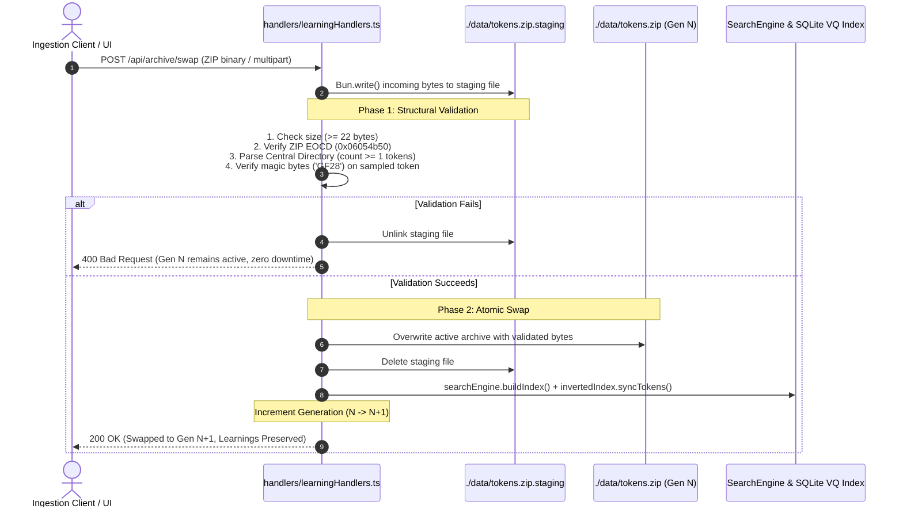

# AGENTS.md — TinyToken Architecture & AI Agent Directives

> **System Overview**: TinyToken is an ultra-dense, self-attesting 25 KB binary token format ($GF(2^8)$ + VQ-VAE + DINOv2 + Ed25519) combined with a high-performance in-memory search engine and a **Persistent Knowledge Layer**.
> 
> This document provides autonomous AI agents with the foundational invariants, architectural contracts, and operational guidelines required to read, modify, and extend TinyToken without corrupting state or conflating conceptual abstractions.

---

## 1. Conceptual Foundation: The 3 Levels of Vision

AI agents must **never** conflate an individual VQ centroid with a semantic object or texture:

```
┌────────────────────────────────────────────────────────────────────────┐
│                        WHAT A CENTROID ACTUALLY IS                     │
│                                                                        │
│ In utils/vqCodebook.ts, VQ_CODEBOOK is a 6×7×6 RGB lattice:           │
│   • 252 discrete (R, G, B) color cells                                 │
│   • 4 high-contrast greyscale anchors (black, charcoal, silver, white) │
│                                                                        │
│ Centroid #222 is literally { r: 156, g: 168, b: 16 } (an RGB colour). │
│ It has no semantic awareness of "charred wood" on its own.             │
└────────────────────────────────────────────────────────────────────────┘
```

TinyToken organizes visual intelligence into **three hierarchical levels**:

```
                     ┌──────────────────────────────────────────────┐
  LEVEL 3            │             OBJECT INTELLIGENCE              │
  Semantic Entities  │  Human Box + DINOv2 Embedding + VQ Layout   │
                     │  "Charred Tree Trunk", "Red Kangaroo"        │
                     └──────────────────────▲───────────────────────┘
                                            │ composed of
                     ┌──────────────────────┴───────────────────────┐
  LEVEL 2            │            PATTERN INTELLIGENCE              │
  Spatial / Texture  │  Recurring 2D Co-occurrences & Sub-grids     │
                     │  [#222 Charcoal] adjacent to [#252 Black]    │
                     └──────────────────────▲───────────────────────┘
                                            │ composed of
                     ┌──────────────────────┴───────────────────────┐
  LEVEL 1            │            CENTROID INTELLIGENCE             │
  Color Primitives   │  Deterministic RGB / Perceptual Color Palette │
                     │  Centroid #222 = Dark Umber / Charcoal RGB   │
                     └──────────────────────────────────────────────┘
```

* **Level 1 (Centroid Intelligence)**: A single quantized color cell in $GF(2^8)$ ($0\dots 255$). Represents a color primitive, luminance value, or ink anchor.
* **Level 2 (Pattern Intelligence)**: A spatial arrangement, 2D co-occurrence, or local color histogram across a patch (e.g. $4\times 4$ cells). Represents a surface texture (bark, fur, water, asphalt).
* **Level 3 (Object Intelligence)**: Multimodal fusion combining human bounding-box regions, local VQ spatial layouts, and global 384-byte **DINOv2 ViT-S/14 embeddings** (`[CLS]` token). Represents an entity (*"Charred Tree Trunk"*).

---

## 2. Tripartite Knowledge Architecture

TinyToken strictly decouples transient binary content (`data/tokens.zip`) from persistent intelligence. The intelligence layer is divided into three separate JSON stores:

```
┌────────────────────────────────────────────────────────────────────────┐
│                      PERSISTENT KNOWLEDGE LAYER                        │
├───────────────────────────────┬────────────┬───────────────────────────┤
│ File                          │ Mutability │ Role                      │
├───────────────────────────────┼────────────┼───────────────────────────┤
│ 1. manual_token_registry.json │ Persistent │ Level 1 Centroid Traits   │
│ 2. object_registry.json       │ Versioned  │ Level 2/3 Object Recipes  │
│ 3. learning_evidence.json     │ Append-Only│ Grounded Sightings Ledger │
└───────────────────────────────┴────────────┴───────────────────────────┘
```

### Store 1: `manual_token_registry.json` (Level 1)
* **Purpose**: Maps individual centroid IDs ($0\dots 255$) to human-confirmed color names and visual trait categories (`Silhouette`, `Texture`, `ColorSpace`, `StructuralGrid`).
* **Source & Confidence**: Always carries `source: "human_verified"` and `confidence: 1.0` (or `source: "auto_color_namer"` for procedural color labels).

### Store 2: `object_registry.json` (Level 2 & 3)
* **Purpose**: Abstract, versioned object recipes (`AbstractObjectRecipe`).
* **CRITICAL INVARIANT FOR AGENTS**:
  > [!IMPORTANT]
  > **Never make an object definition dependent on a specific token ID!**
  > An object recipe represents an abstract entity. It stores a normalized centroid distribution (`dominantCentroidDist`), spatial priors, and DINOv2 prototype vectors. It must **never** contain an `observedTokenId` or `tokenId` field.

```typescript
export interface AbstractObjectRecipe {
  recipeId: string;            // e.g. "rcp_charred_pine_bark"
  label: string;               // e.g. "Charred Pine Bark"
  category: VisualTraitCategory;
  dominantCentroidDist: Record<number, number>; // Normalized histogram (e.g. {"222": 0.45, "180": 0.35})
  spatialAdjacencyPriors?: [number, number][];  // Co-occurring centroid pairs
  dinoPrototypeVector?: number[];               // 384-dim normalized prototype vector
  source: LearningSource;
  confidence: number;          // 1.0 (verified), 0.3 (suggestion)
  version: number;             // Model generation: increments ONLY on material distribution drift (>10%) or consolidation
  observationCount: number;    // Running count of concrete sightings across all tokens (avoids eager version inflation)
  createdAt: string;           // ISO 8601 UTC
  updatedAt: string;           // ISO 8601 UTC
}
```

### Store 3: `learning_evidence.json` (Observation Ledger)
* **Purpose**: Append-oriented log recording concrete, grounded sightings on specific image tokens.
* **Fields**: Every sighting references the observed token, the bounding box, covered centroids, geographic coordinates (with default Sydney NSW coordinates `-33.8688, 151.2093`), UTC timestamp, and confidence.

```typescript
export interface LearningEvidenceRecord {
  evidenceId: string;          // e.g. "evi_1793500200_abc12"
  recipeId: string;            // Foreign key to AbstractObjectRecipe
  label: string;
  category: VisualTraitCategory;
  observedTokenId: string;     // Grounded token instance (e.g. "tok_00001_AfterFire1.jpg")
  sourceArchiveHash?: string;  // CRC-32 of active tokens.zip
  boundingBox: [number, number, number, number]; // [ymin, xmin, ymax, xmax] 0..1
  observedCentroids: number[]; // Centroid IDs covered by bounding box
  latitude: number;            // Default: -33.8688
  longitude: number;           // Default: 151.2093
  utcTimestamp: string;        // ISO 8601 UTC timestamp
  observedAt: string;          // Preserved local/ISO timestamp
  source: LearningSource;      // "human_verified" | "human_suggested" | "model_cluster"
  confidence: number;          // 1.0 (verified), 0.3 (suggestion)
}
```

---

## 3. Transactional Generation-Based Archive Swapping

TinyToken provides a dual-buffered, generation-based hot-swap mechanism managed by [`ArchiveManager`](file:///c:/Users/risto/source/repos/tinytoken/utils/archiveManager.ts) and [`LearningHandlers`](file:///c:/Users/risto/source/repos/tinytoken/handlers/learningHandlers.ts).

### Why It Exists
Users can upload, replace, or swap `tokens.zip` at runtime with an entirely new dataset **without deleting or invalidating learned intelligence**. Because VQ centroids and DINOv2 embeddings operate in a universal vector space, all previously learned traits and recipes transfer **zero-shot** to the newly ingested image tokens.

### Two-Phase Commit Lifecycle



### Invariants for Agents
1. **Rollback by Default**: Any malformed ZIP, zero-token archive, or invalid magic bytes aborts the swap. The existing archive remains active.
2. **Knowledge Isolation**: The swap operation has **zero write access** to `manual_token_registry.json`, `object_registry.json`, or `learning_evidence.json`.
3. **Generation Tracking**: Each successful swap increments `generation` ($1, 2, 3\dots$) and updates `swappedAt` and `archiveCrc32Hex`.

---

## 4. HTTP API Endpoints

All mutating endpoints (`POST`) enforce same-origin verification via [`verifySameOriginMutation`](file:///c:/Users/risto/source/repos/tinytoken/utils/response.ts#L64).

| Method | Endpoint | Handler Method | Request Body / Content-Type | Description |
| :--- | :--- | :--- | :--- | :--- |
| `POST` | `/api/archive/swap` | `LearningHandlers.handleArchiveSwap` | `application/zip`, `application/octet-stream`, or `multipart/form-data` | **Second Ingestion Path**: Transactionally validates and hot-swaps active `tokens.zip`. Increments archive generation. |
| `GET` | `/api/archive/status` | `LearningHandlers.handleArchiveStatus` | None | Returns active generation, total tokens, file size, CRC-32, and counts of traits/recipes/evidence. |
| `GET` | `/api/learning/recipes` | `LearningHandlers.handleGetRecipes` | None | Returns all versioned, token-independent `AbstractObjectRecipe` records. |
| `GET` | `/api/learning/evidence` | `LearningHandlers.handleGetEvidence` | None | Returns all append-only `LearningEvidenceRecord` observations. |
| `POST` | `/api/learning/evidence` | `LearningHandlers.handleRecordEvidence` | `application/json` (`tokenId`, `label`, `boundingBox`, `centroidIds`, etc.) | Directly appends an observation to the evidence ledger and updates the recipe. |
| `POST` | `/api/token/:id/teach` | `TokenApiHandlers.handleTeachObject` | `application/json` (`label`, `category`, `boundingBox`, `centroidIds`) | User bounding-box teaching: updates Level 1 traits, creates/updates Level 2/3 recipe, and logs evidence. |
| `GET` | `/api/objects` | `TokenApiHandlers.handleGetObjectAnnotations` | None | Backward-compatible annotation list derived from the evidence ledger for UI overlays. |
| `GET` | `/api/registry` | `TokenApiHandlers.handleGetRegistry` | None | Returns all Level 1 centroid trait mappings ($0\dots 255$). |
| `POST` | `/api/index/rebuild` | `TokenApiHandlers.handleRebuildIndex` | `application/json` | Rebuilds `tokens.zip` from local source directory (Image Pipeline path). |

---

## 5. Agent Development & Engineering Rules

When modifying or extending this codebase, agents must strictly follow these rules:

1. **Use TypeScript and Bun Native I/O**:
   - Always use `Bun.file(path)`, `Bun.write(path, data)`, and `Bun.Glob`.
   - Never import or use Node's `fs` or `fs/promises`.
2. **Never Conflate Learning Tiers**:
   - Do not write object labels directly into centroid slots unless explicitly marked as a dominant representative.
   - Never write a `tokenId` into `object_registry.json`.
3. **Always Set Provenance & Confidence**:
   - When a human explicitly names or confirms a trait/recipe, set `source: "human_verified"` and `confidence: 1.0`.
   - When clustering or auto-suggesting, set `source: "human_suggested"` or `source: "model_cluster"` with `confidence: 0.3` (or model score).
4. **Always Populate Geo & Temporal Context**:
   - If token metadata lacks GPS, default to NSW/Australia coordinates: `latitude = -33.8688`, `longitude = 151.2093`.
   - Always record both `utcTimestamp` (ISO 8601 UTC) and `observedAt`.
5. **Run Test Suites Before Submitting Changes**:
   - All tests must pass: `bun test`.
   - Ensure both `tests/token.test.ts` and `tests/learning.test.ts` pass with zero regressions.

