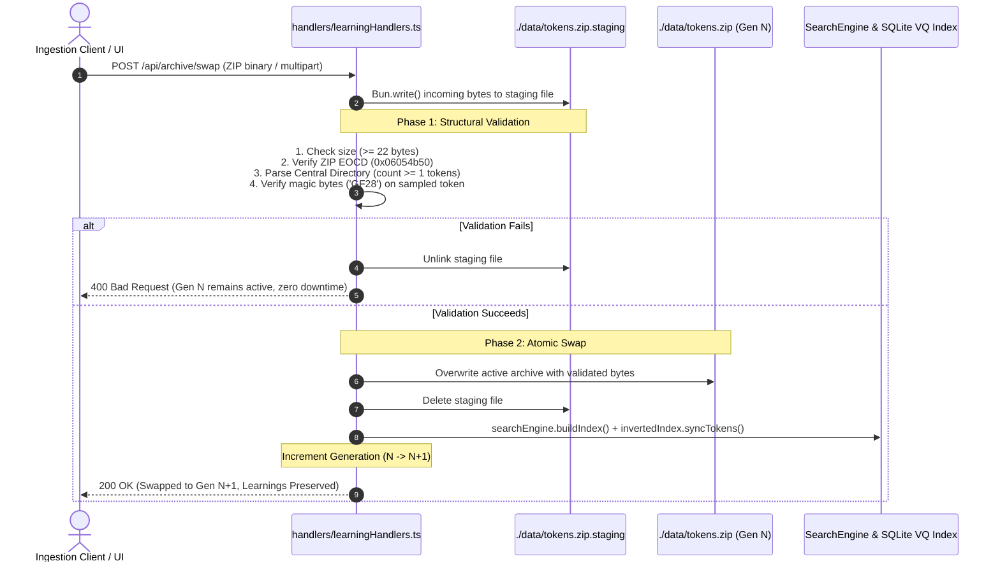

# AGENTS.md — TinyToken Architecture & AI Agent Directives

> **System Overview**: TinyToken is an ultra-dense, self-attesting 25 KB binary token format ($GF(2^8)$ + VQ-VAE + DINOv3 + Ed25519) combined with a high-performance in-memory search engine and a **Persistent Knowledge Layer**.
> Note that as the project is 'in dev', not every filetype's implementation and operational defaults are enforced consistently.
> This document provides autonomous AI agents with the foundational invariants, architectural contracts, and operational guidelines required to read, modify, and extend TinyToken without corrupting state or conflating conceptual abstractions.

---

## 1. Conceptual Foundation: The 3 Levels of Vision

AI agents must **never** conflate an individual VQ centroid with a semantic object or texture:

```
┌────────────────────────────────────────────────────────────────────────┐
│                        WHAT A CENTROID ACTUALLY IS                     │
│                                                                        │
│ In utils/vqCodebook.ts, VQ_CODEBOOK is a 6×7×6 RGB lattice:           │
│   • 252 discrete (R, G, B) color cells                                 │
│   • 4 high-contrast greyscale anchors (black, charcoal, silver, white) │
│                                                                        │
│ Centroid #222 is literally { r: 156, g: 168, b: 16 } (an RGB colour). │
│ It has no semantic awareness of "charred wood" on its own.             │
└────────────────────────────────────────────────────────────────────────┘
```

TinyToken organizes visual intelligence into **three hierarchical levels**:

```
                     ┌──────────────────────────────────────────────┐
  LEVEL 3            │             OBJECT INTELLIGENCE              │
  Semantic Entities  │  Human Box + DINOv3 Embedding + VQ Layout   │
                     │  "Charred Tree Trunk", "Red Kangaroo"        │
                     └──────────────────────▲───────────────────────┘
                                            │ composed of
                     ┌──────────────────────┴───────────────────────┐
  LEVEL 2            │            PATTERN INTELLIGENCE              │
  Spatial / Texture  │  Recurring 2D Co-occurrences & Sub-grids     │
                     │  [#222 Charcoal] adjacent to [#252 Black]    │
                     └──────────────────────▲───────────────────────┘
                                            │ composed of
                     ┌──────────────────────┴───────────────────────┐
  LEVEL 1            │            CENTROID INTELLIGENCE             │
  Color Primitives   │  Deterministic RGB / Perceptual Color Palette │
                     │  Centroid #222 = Dark Umber / Charcoal RGB   │
                     └──────────────────────────────────────────────┘
```

* **Level 1 (Centroid Intelligence)**: A single quantized color cell in $GF(2^8)$ ($0\dots 255$). Represents a color primitive, luminance value, or ink anchor.
* **Level 2 (Pattern Intelligence)**: A spatial arrangement, 2D co-occurrence, or local color histogram across a patch (e.g. $4\times 4$ cells). Represents a surface texture (bark, fur, water, asphalt).
* **Level 3 (Object Intelligence)**: Multimodal fusion combining human bounding-box regions, local VQ spatial layouts, and global 384-byte **DINOv3 ViT-S/16 embeddings** (`[CLS]` token). Represents an entity (*"Charred Tree Trunk"*).

---

## 2. Tripartite Knowledge Architecture

TinyToken strictly decouples transient binary content (`data/tokens.zip`) from persistent intelligence. The intelligence layer is divided into three separate JSON stores:

```
┌────────────────────────────────────────────────────────────────────────┐
│                      PERSISTENT KNOWLEDGE LAYER                        │
├───────────────────────────────┬────────────┬───────────────────────────┤
│ File                          │ Mutability │ Role                      │
├───────────────────────────────┼────────────┼───────────────────────────┤
│ 1. manual_token_registry.json │ Persistent │ Level 1 Centroid Traits   │
│ 2. object_registry.json       │ Versioned  │ Level 2/3 Object Recipes  │
│ 3. learning_evidence.json     │ Append-Only│ Grounded Sightings Ledger │
└───────────────────────────────┴────────────┴───────────────────────────┘
```

### Store 1: `manual_token_registry.json` (Level 1)
* **Purpose**: Maps individual centroid IDs ($0\dots 255$) to human-confirmed color names and visual trait categories (`Silhouette`, `Texture`, `ColorSpace`, `StructuralGrid`).
* **Source & Confidence**: Always carries `source: "human_verified"` and `confidence: 1.0` (or `source: "auto_color_namer"` for procedural color labels).

### Store 2: `object_registry.json` (Level 2 & 3)
* **Purpose**: Abstract, versioned object recipes (`AbstractObjectRecipe`).
* **CRITICAL INVARIANT FOR AGENTS**:
  > [!IMPORTANT]
  > **Never make an object definition dependent on a specific token ID!**
  > An object recipe represents an abstract entity. It stores a normalized centroid distribution (`dominantCentroidDist`), spatial priors, and DINOv3 prototype vectors. It must **never** contain an `observedTokenId` or `tokenId` field.

```typescript
export interface AbstractObjectRecipe {
  recipeId: string;            // e.g. "rcp_charred_pine_bark"
  label: string;               // e.g. "Charred Pine Bark"
  category: VisualTraitCategory;
  dominantCentroidDist: Record<number, number>; // Normalized histogram (e.g. {"222": 0.45, "180": 0.35})
  spatialAdjacencyPriors?: [number, number][];  // Co-occurring centroid pairs
  dinoPrototypeVector?: number[];               // 384-dim normalized prototype vector
  source: LearningSource;
  confidence: number;          // 1.0 (verified), 0.3 (suggestion)
  version: number;             // Model generation: increments ONLY on material distribution drift (>10%) or consolidation
  observationCount: number;    // Running count of concrete sightings across all tokens (avoids eager version inflation)
  createdAt: string;           // ISO 8601 UTC
  updatedAt: string;           // ISO 8601 UTC
}
```

### Store 3: `learning_evidence.json` (Observation Ledger)
* **Purpose**: Append-oriented log recording concrete, grounded sightings on specific image tokens.
* **Fields**: Every sighting references the observed token, the bounding box, covered centroids, geographic coordinates (with default Sydney NSW coordinates `-33.8688, 151.2093`), UTC timestamp, and confidence.

```typescript
export interface LearningEvidenceRecord {
  evidenceId: string;          // e.g. "evi_1793500200_abc12"
  recipeId: string;            // Foreign key to AbstractObjectRecipe
  label: string;
  category: VisualTraitCategory;
  observedTokenId: string;     // Grounded token instance (e.g. "tok_00001_AfterFire1.jpg")
  sourceArchiveHash?: string;  // CRC-32 of active tokens.zip
  boundingBox: [number, number, number, number]; // [ymin, xmin, ymax, xmax] 0..1
  observedCentroids: number[]; // Centroid IDs covered by bounding box
  latitude: number;            // Default: -33.8688
  longitude: number;           // Default: 151.2093
  utcTimestamp: string;        // ISO 8601 UTC timestamp
  observedAt: string;          // Preserved local/ISO timestamp
  source: LearningSource;      // "human_verified" | "human_suggested" | "model_cluster"
  confidence: number;          // 1.0 (verified), 0.3 (suggestion)
}
```

---

## 3. Transactional Generation-Based Archive Swapping

TinyToken provides a dual-buffered, generation-based hot-swap mechanism managed by [`ArchiveManager`](file:///c:/Users/risto/source/repos/tinytoken/utils/archiveManager.ts) and [`LearningHandlers`](file:///c:/Users/risto/source/repos/tinytoken/handlers/learningHandlers.ts).

### Why It Exists
Users can upload, replace, or swap `tokens.zip` at runtime with an entirely new dataset **without deleting or invalidating learned intelligence**. Because VQ centroids and DINOv3 embeddings operate in a universal vector space, all previously learned traits and recipes transfer **zero-shot** to the newly ingested image tokens.

### Two-Phase Commit Lifecycle



### Invariants for Agents
1. **Rollback by Default**: Any malformed ZIP, zero-token archive, or invalid magic bytes aborts the swap. The existing archive remains active.
2. **Knowledge Isolation**: The swap operation has **zero write access** to `manual_token_registry.json`, `object_registry.json`, or `learning_evidence.json`.
3. **Generation Tracking**: Each successful swap increments `generation` ($1, 2, 3\dots$) and updates `swappedAt` and `archiveCrc32Hex`.

---

## 4. HTTP API Endpoints

All mutating endpoints (`POST`) enforce same-origin verification via [`verifySameOriginMutation`](file:///c:/Users/risto/source/repos/tinytoken/utils/response.ts#L64).

| Method | Endpoint | Handler Method | Request Body / Content-Type | Description |
| :--- | :--- | :--- | :--- | :--- |
| `POST` | `/api/archive/swap` | `LearningHandlers.handleArchiveSwap` | `application/zip`, `application/octet-stream`, or `multipart/form-data` | **Second Ingestion Path**: Transactionally validates and hot-swaps active `tokens.zip`. Increments archive generation. |
| `GET` | `/api/archive/status` | `LearningHandlers.handleArchiveStatus` | None | Returns active generation, total tokens, file size, CRC-32, and counts of traits/recipes/evidence. |
| `GET` | `/api/learning/recipes` | `LearningHandlers.handleGetRecipes` | None | Returns all versioned, token-independent `AbstractObjectRecipe` records. |
| `GET` | `/api/learning/evidence` | `LearningHandlers.handleGetEvidence` | None | Returns all append-only `LearningEvidenceRecord` observations. |
| `POST` | `/api/learning/evidence` | `LearningHandlers.handleRecordEvidence` | `application/json` (`tokenId`, `label`, `boundingBox`, `centroidIds`, etc.) | Directly appends an observation to the evidence ledger and updates the recipe. |
| `POST` | `/api/token/:id/teach` | `TokenApiHandlers.handleTeachObject` | `application/json` (`label`, `category`, `boundingBox`, `centroidIds`) | User bounding-box teaching: updates Level 1 traits, creates/updates Level 2/3 recipe, and logs evidence. |
| `GET` | `/api/objects` | `TokenApiHandlers.handleGetObjectAnnotations` | None | Backward-compatible annotation list derived from the evidence ledger for UI overlays. |
| `GET` | `/api/registry` | `TokenApiHandlers.handleGetRegistry` | None | Returns all Level 1 centroid trait mappings ($0\dots 255$). |
| `POST` | `/api/index/rebuild` | `TokenApiHandlers.handleRebuildIndex` | `application/json` | Rebuilds `tokens.zip` from local source directory (Image Pipeline path). |

---

## 5. Agent Development & Engineering Rules

When modifying or extending this codebase, agents must strictly follow these rules:
## 5. Agent Development & Engineering Rules
1. **Use TypeScript and Bun Native Features Always**:
   - Always use `Bun.file(path)`, `Bun.write(path, data)`, `Bun.nanoseconds()`, and `Bun.Glob`.
   - Never import or use Node's `fs` or `fs/promises`.
2. **Prefer Simple, Direct Code**:
   - Avoid speculative abstraction layers; do the same work with less indirection.
3. **Never Conflate Learning Tiers**:
   - Do not write object labels directly into centroid slots unless explicitly marked as a dominant representative.
   - Never write a `tokenId` into `object_registry.json`.
4. **Always Set Provenance & Confidence**:
   - When a human explicitly names or confirms a trait/recipe, set `source: "human_verified"` and `confidence: 1.0`.
   - When clustering or auto-suggesting, set `source: "human_suggested"` or `source: "model_cluster"` with `confidence: 0.3` (or model score).
5. **Always Populate Geo & Temporal Context**:
   - If token metadata lacks GPS, default to ACT/Australia coordinates: `latitude = -35.1843`, `longitude = 149.1328`.
   - Always record both `utcTimestamp` (ISO 8601 UTC) and `observedAt`.
6. **Run Test Suites Before Submitting Changes**:
   - All tests must pass: `bun test`.
   - Ensure both `tests/token.test.ts` and `tests/learning.test.ts` pass with zero regressions.
7. **Size and speed are essential**:
   - If developer needs features/ increase fields sizes/ anything that will slow processing, report and ask immediately.
   - Suggest improvements immediately, be proactive.
   - Ensure that tokens's size stays below 25Kb and ask before any field size increase immediately.
   - Do simple optimisation when there is a clear benefit, like calculate and use precalculated (multidim)arrays and codepages, report generation.

## Learning

#### The Dual-Score Metric (Color + Semantic Geometry)

In a new environment, lighting or camera white balance will shift raw RGB values, but the underlying object semantics remain stable. You evaluate matches using a fused score combining Level 1/2 VQ Centroid 		​

Histogram Intersection (VQ Overlap): Measures whether the same material/color pigments (e.g. umber charcoal #222, terracotta clay #97) are present in the new scene.
DINOv3 Cosine Similarity: Invariant to illumination and viewpoint changes; ensures the candidate actually has the shape and semantic structure of the entity.
Set 
𝛼
=
0.60
α=0.60 for illumination-robust matching, or 
𝛼
=
0.30
α=0.30 when material color fidelity is critical.
Step 2. Operational Evaluation Protocol

After hot-swapping to a new tokens.zip via the Ingest Archive button:

┌────────────────────────────────────────────────────────────────────────┐
│                        EVALUATION WORKFLOW                             │
│                                                                        │
│  1. Pick Recipe   ──►  2. Rank Archive  ──►  3. Inspect Top Hits       │
│     (e.g. "Kangaroo")    (ADC + DINO)          (Precision @ K)         │
│                                                      │                 │
│                                                      ▼                 │
│                                              4. Drift Audit            │
│                                           (Confirmed vs Shifted)       │
└────────────────────────────────────────────────────────────────────────┘
#### Rank the New Archive

Compute the fused score for every token in the newly swapped archive against your recipe (e.g. "Charred Tree Trunk").
Sort the tokens in descending order of similarity score.

#### Measure Precision @ K (e.g. Top 5 / Top 10 Hits)

True Positives: Top-ranked hits that genuinely contain the entity 
⟹
⟹ High generalization.
False Positives: Top-ranked hits that contain similar colors but the wrong entity (e.g. reddish soil mistaken for kangaroo fur) 
⟹ Centroid over-reliance; increase DINOv3 weight 𝛼
α or add spatial adjacency priors.

#### Calculate Centroid Distribution Drift (Δ)

For the verified instances in the new environment, calculate their centroid histogram 𝑃 new  versus the baseline recipe  𝑃 old


> Outcome: The recipe becomes multi-environmental — robust to both the original baseline and the new lighting/terrain conditions.


## 16×16 VQ Codebook Grid (256 Bytes) - Spatial color distribution
Uncompressed visual fingerprint

TinyToken, spatial color distribution means the 256 bytes in the 
16 × 16 lattice preserve where colors sit in the 2D plane (top vs bottom, center vs edges, adjacency pairs), rather than just counting how many red or green pixels exist.

Across thousands of tokens, this enables 5 key capabilities:

1. Instant Visual Similarity Search (Query-by-Example / Reverse Image Search)

A flat color histogram cannot tell the difference between:

A blue car parked on green grass.
A green roof under a blue sky.

Because both have identical percentages of blue and green. But in the 
16 × 16 spatial grid, the sky is in cells 0..63 (top rows) and the grass is in cells 192..255 (bottom rows).

When comparing a query token to thousands of catalog tokens:

```typescript
// utils/vqCodebook.ts — Asymmetric Distance Computation (ADC)
let totalDistance = 0;
for (let i = 0; i < 256; i++) {
  // O(1) memory lookup in precomputed 256x256 distance LUT
  totalDistance += VQ_DISTANCE_LUT[queryGrid[i] * 256 + candidateGrid[i]];
}
```

Performance Math: 256 integer lookups takes 
≈ 0.15  
𝜇 s ≈0.15 μs. Evaluating 10,000 candidate tokens in RAM takes just 
1.5 ms—completely without GPUs, neural inference, or decompressing any JPEG/WebP files.
2. High-Speed Candidate Pruning via SQLite Inverted Index

In utils/vqInvertedIndex.ts, spatial centroids are stored in Bun's built-in in-memory SQLite table:

```sql
SELECT image_id, COUNT(*) AS overlapping_centroids, SUM(frequency) AS score
FROM image_tokens
WHERE token_id IN (222, 252, 180) -- e.g. Charcoal, Black, Umber
GROUP BY image_id
ORDER BY score DESC LIMIT 50;
```

Usage: Instantly prunes an archive of 50,000+ tokens down to the top 20 candidate matches in  < 0.3  ms before running heavier neural models.

3. The Dual-Score Metric: Semantic Geometry + Material Fidelity

As outlined in AGENTS.md, AI agents match objects in new environments using a fused metric:
Fused Score
= 𝛼 ⋅
DINOv3_Cosine
+  (  1  −  𝛼 ) ⋅
VQ_Overlap
Fused Score=α⋅DINOv3_Cosine+(1−α)⋅VQ_Overlap

DINOv3 provides illumination-invariant shape and semantic understanding ("this is a kangaroo").
Spatial VQ Overlap verifies material and pigment fidelity ("it has the red-ochre fur pattern of an Australian Red Kangaroo, not the grey coat of an Eastern Grey").
Setting 𝛼 = 0.60 allows robust detection across changing daylight or camera white balances.
4. Fast Unsupervised Clustering & Scene Classification

Because every token maps into a fixed 256-dimensional discrete vector (
𝐺
𝐹
(
2
8
)
256
GF(2
8
)
256
):

Thousands of tokens can be clustered in RAM using K-Means or DBSCAN  in  <50 ms. Automatically groups large archives into visual categories:
Documents / Text: White paper background (#255) with high black ink contrast (#252).
Landscape: Cyan/blue gradients across the top 4 rows, earthy greens/browns across the bottom 12 rows.
Portraits: Skin tones concentrated in the central 
8×8 bounding cells.


5. Grounded Bounding-Box Object Teaching (Level 2 & 3 Vision)

When a user draws a bounding box on an image (e.g. 

[ymin,xmin,ymax,xmax]):

The coordinates map directly to the corresponding subgrid of cells in the  16×16 lattice.
The system extracts the local co-occurrence frequencies (e.g. #222 Charcoal adjacent to #252 Black).
This creates a token-independent AbstractObjectRecipe stored in object_registry.json, allowing TinyToken to search for that texture or entity across thousands of other images zero-shot.