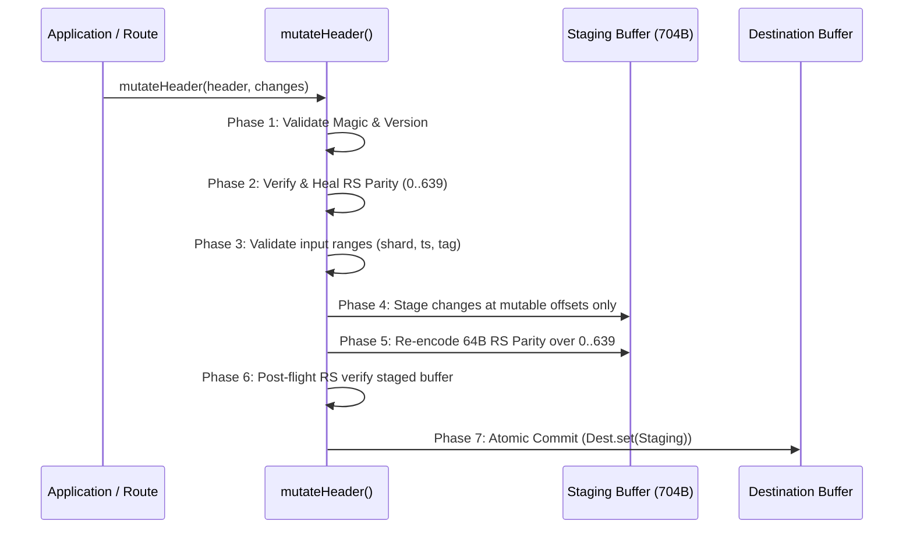

# STRUCT.md — Formal TinyToken Binary Specification (Version 1)

> **Specification Authority**: TinyToken GF(2^8) + VQ-VAE + DINOv3 + Ed25519 Binary Container Standard  
> **Container File Identifier**: `GF28` (`0x47, 0x46, 0x32, 0x38`)  
> **Specification Version**: 1  
> **Maximum Container Size**: 25,600 bytes (25.0 KB strict)  
> **Reference Implementation**: Bun v1.4+ / TypeScript ([`utils/tokenCodec.ts`](, [`utils/galois.ts`]([`utils/galois.ts`]), [`utils/snarkAttest.ts`]))

---

## 1. High-Level Architecture & Envelope Budget

A TinyToken is a fixed-envelope binary token with a strict maximum size of **25,600 bytes (25 KB)**. It consists of three contiguous, non-overlapping sections:

```
┌────────────────────────────────────────────────────────────────────────────────────────┐
│                                 TINYTOKEN V1 BINARY ENVELOPE                          │
│                                (Maximum: 25,600 Bytes)                                 │
├──────────────────────────┬─────────────────────────────┬───────────────────────────────┤
│ Section I: Fixed Header  │ Section II: Metadata & OCR  │ Section III: Preview Payload  │
│ Offset: 0 .. 703         │ Offset: 704 .. (703 + Lmeta)│ Offset: (704 + Lmeta) .. Total│
│ Length: Exactly 704 B    │ Length: Up to 4,096 B       │ Length: Up to 20,800 B        │
├──────────────────────────┼─────────────────────────────┼───────────────────────────────┤
│ • Fixed Binary Header    │ • QuickLZ / UTF-8 JSON      │ • Lossy WebP / AVIF / JPEG    │
│ • Ed25519 Attestation    │ • Structural Payload Detect │ • Vector SVG                  │
│ • VQ 16×16 Latent Grid   │ • Dual DINOv3 + BGE Vectors │ • Direct zero-copy slice      │
│ • 3-Lane GF(2^8) RS (64B)│ • Graceful OCR truncation   │ • Bounded by envelope budget  │
└──────────────────────────┴─────────────────────────────┴───────────────────────────────┘
```

### Envelope Invariant Equation
$$\text{TotalSize} = 704 + L_{\text{meta}} + L_{\text{preview}} \le 25,600 \text{ bytes}$$

Where:
* $L_{\text{meta}} \in [0, 4096]$
* $L_{\text{preview}} \in [0, 20800]$
* $L_{\text{meta}} + L_{\text{preview}} \le 24,896$

---

## 2. Section I: Fixed Binary Header (Offsets 0 .. 703)

Section I is exactly **704 bytes** in length. All multi-byte numeric fields are encoded in **Little-Endian** byte order.

### 2.1 Complete Byte Map

| Offset Range | Size | Type | Field Name | Valid Range / Format | Mutability | Description |
| :--- | :--- | :--- | :--- | :--- | :--- | :--- |
| `0 .. 3` | 4 B | ASCII | `magic` | `"GF28"` (`0x47, 0x46, 0x32, 0x38`) | **Constant** | Binary container magic identifier. |
| `4 .. 5` | 2 B | Uint16LE | `version` | `1` (`0x0001`) | **Constant** | Specification version number. |
| `6 .. 7` | 2 B | Uint16LE | `flags` | Bitmask (`0x0000..0xFFFF`) | **Mutable** | Operational decoding hints and capability flags. |
| `8 .. 23` | 16 B | Raw Bytes | `uuid` | 128-bit UUID (RFC 4122) | **Signed** | Unique immutable asset identifier. |
| `24 .. 27` | 4 B | Uint32LE | `originalFileSize`| $0 \dots 2^{32}-1$ bytes | **Signed** | Source uncompressed file size in bytes. |
| `28 .. 31` | 4 B | Uint32LE | `metaLength` | $0 \dots 4096$ bytes | **Signed*** | Byte length of Section II ($L_{\text{meta}}$). |
| `32 .. 35` | 4 B | Uint32LE | `previewLength` | $0 \dots 20800$ bytes | **Signed*** | Byte length of Section III ($L_{\text{preview}}$). |
| `36 .. 37` | 2 B | Uint16LE | `width` | $0 \dots 65535$ pixels | **Signed** | Native source image/document width. |
| `38 .. 39` | 2 B | Uint16LE | `height` | $0 \dots 65535$ pixels | **Signed** | Native source image/document height. |
| `40 .. 41` | 2 B | Uint16LE | `page` | $1 \dots 65535$ | **Signed** | Page index for multi-page documents (1-based). |
| `42 .. 43` | 2 B | Uint16LE | `previewFormat` | `0..6` enum | **Signed** | Image preview encoding format (see §2.3). |
| `44 .. 75` | 32 B | Raw Bytes | `contentId` | 32-byte SHA-256 Hash | **Signed** | **Merkle Root / ContentId (CID)** committing to all 4 leaves. |
| `76 .. 79` | 4 B | Uint32LE | `shardBlockId` | $0 \dots 2^{32}-1$ | **Mutable** | Distributed storage partition / shard cluster ID. |
| `80 .. 81` | 2 B | Uint16LE | `shardIndex` | $0 \dots 63$ | **Mutable** | Shard coordinate index within distributed block. |
| `82 .. 87` | 6 B | 48-bit LE | `timestamp` | Milliseconds since Unix epoch | **Mutable** | Routing / state mutation epoch (Low 32b at 82, High 16b at 86). |
| `88` | 1 B | Uint8 | `homomorphicTag`| $0 \dots 255 \in GF(2^8)$ | **Mutable** | Reversible algebraic state watermark / redaction scalar. |
| `89` | 1 B | Uint8 | `embeddingModelId`| `0x00..0x04` enum | **Signed** | Neural model architecture used for semantic embeddings. |
| `90 .. 127` | 38 B | Bytes | `reserved` | Zero-filled (`0x00`) | **Reserved** | Reserved for post-quantum attestation extensions. |
| `128 .. 383`| 256 B | Struct | `snarkStub` | Attestation Block (see §3) | **Signed** | 256-byte Ed25519 signature and Merkle commitment block. |
| `384 .. 639`| 256 B | Raw Bytes | `vqIndices` | 256 elements $\in GF(2^8)$ | **Signed** | $16 \times 16$ spatial visual quantized codebook grid. |
| `640 .. 703`| 64 B | Raw Bytes | `rsParity` | 64 parity bytes $\in GF(2^8)$ | **RS Lane** | 3-lane Reed-Solomon parity covering bytes `0..639`. |

*\* `metaLength` and `previewLength` are implicitly authenticated because Leaf 1 and Leaf 2 commit to the exact payload bytes.*

### 2.2 Token Flags (`flags`, Bits 0..15)

The 16-bit flag register at offset `6..7` defines operational capabilities:

| Bit | Hex Value | Name | Description |
| :--- | :--- | :--- | :--- |
| `0` | `0x0001` | `HAS_VQ_GRID` | Indicates Section I contains a populated 256-byte VQ $16 \times 16$ grid. |
| `1` | `0x0002` | `SNARK_ATTESTED` | Cryptographic Ed25519 provenance attestation signature verified. |
| `2` | `0x0004` | `QUICKLZ_COMPRESSED` | Section II metadata payload was encoded via QuickLZ level 1. |
| `3` | `0x0008` | `HOMOMORPHIC_MASKED`| Header state has undergone a $GF(2^8)$ algebraic linear permutation. |
| `4` | `0x0010` | `MULTI_PAGE_DOC` | Token represents a page within a multi-page document (`totalPages > 1`). |
| `5` | `0x0020` | `HAS_DINO_EMBEDDING` | Section II metadata holds a 384-dimensional DINOv3 Int8 vector. |
| `6` | `0x0040` | `HAS_BGE_EMBEDDING` | Section II metadata holds a 384-dimensional BGE-small-en-v1.5 Int8 vector. |
| `7..15`| `0xFF80` | `RESERVED` | Reserved for future capability flags (must be zero). |

### 2.3 Preview Formats (`previewFormat`, Offset 42..43)

| ID | Name | MIME Type | Description |
| :--- | :--- | :--- | :--- |
| `0` | `UNKNOWN` | `application/octet-stream` | Undefined format. |
| `1` | `AVIF` | `image/avif` | Ultra-compact AV1 image preview. |
| `2` | `WEBP` | `image/webp` | Default 220×220 lossy WebP preview. |
| `3` | `JPEG` | `image/jpeg` | Standard baseline JPEG preview. |
| `4` | `PNG` | `image/png` | Lossless RGBA PNG preview. |
| `5` | `BMP` | `image/bmp` | Uncompressed bitmap preview. |
| `6` | `SVG` | `image/svg+xml` | Vector SVG preview (sandboxed with CSP `default-src 'none'`). |

### 2.4 Embedding Model IDs (`embeddingModelId`, Offset 89)

| ID | Model Architecture | Embedding Dim | Quantization | Description |
| :--- | :--- | :--- | :--- | :--- |
| `0x00` | `NONE` | 0 | None | No semantic vector present. |
| `0x01` | `COLOR_HOG_FALLBACK` | 384 | Int8 | Synchronous procedural Color/HOG fallback descriptor. |
| `0x02` | `DINOV3_VITS16_Q8` | 384 | Int8 | Meta DINOv3 ViT-S/16 ONNX (`[CLS]` token, normalized). |
| `0x03` | `BGE_TEXT_FALLBACK` | 384 | Int8 | Procedural text embedding fallback. |
| `0x04` | `BGE_SMALL_EN_V15_Q8` | 384 | Int8 | BAAI BGE-small-en-v1.5 ONNX (dense text embedding, normalized). |

---

## 3. Cryptographic Provenance & Attestation Block (Offsets 128 .. 383)

The 256-byte attestation block provides unforgeable cryptographic authenticity across all sections via asymmetric Ed25519 signing over a domain-separated SHA-256 Merkle tree.

```
Offsets relative to Attestation Block start (Offset 128):
0       4                  36                 68                 100                132                164                          228        236        256
┌───────┬──────────────────┬──────────────────┬──────────────────┬──────────────────┬──────────────────┬────────────────────────────┬──────────┬──────────┐
│ Magic │ Leaf 0 (Origin)  │ Leaf 1 (Preview) │ Leaf 2 (Meta)    │ Leaf 3 (VQ Grid) │ Signer PubKey    │ Ed25519 Signature          │ Key ID   │ GF28 Tags│
│ 4 B   │ 32 B             │ 32 B             │ 32 B             │ 32 B             │ 32 B (Raw)       │ 64 B (Detached)            │ 8 B      │ 20 B     │
└───────┴──────────────────┴──────────────────┴──────────────────┴──────────────────┴──────────────────┴────────────────────────────┴──────────┴──────────┘
```

### 3.1 Sub-Field Offsets

| Sub-Offset | Abs Offset | Size | Field Name | Description |
| :--- | :--- | :--- | :--- | :--- |
| `0 .. 3` | `128 .. 131` | 4 B | `attestMagic` | ASCII `"ED25"` (`0x45, 0x44, 0x32, 0x35`). |
| `4 .. 35` | `132 .. 163` | 32 B | `originHash` | **Leaf 0**: SHA-256 commitment over Origin Header descriptor. |
| `36 .. 67` | `164 .. 195` | 32 B | `previewHash` | **Leaf 1**: SHA-256 commitment over Section III preview payload. |
| `68 .. 99` | `196 .. 227` | 32 B | `metaHash` | **Leaf 2**: SHA-256 commitment over Section II metadata payload. |
| `100 .. 131`| `228 .. 259` | 32 B | `vqHash` | **Leaf 3**: SHA-256 commitment over Section I VQ 16×16 grid. |
| `132 .. 163`| `260 .. 291` | 32 B | `signerPubKey` | Raw 32-byte Ed25519 public key of the certifying authority. |
| `164 .. 227`| `292 .. 355` | 64 B | `signature` | Detached Ed25519 signature over 188-byte canonical transcript. |
| `228 .. 235`| `356 .. 363` | 8 B | `keyId` | Signer Key ID: `SHA-256("TT-KEYID-v3:" || pubKey)[0..7]`. |
| `236 .. 255`| `364 .. 383` | 20 B | `gf28AuditTags` | 20-byte $GF(2^8)$ polynomial evaluation tags over signature. |

---

## 4. Exact Merkle Leaf & Tree Construction

TinyToken utilizes a strictly domain-separated, 4-leaf balanced binary Merkle tree:

```
                            ┌────────────────────────┐
                            │    Merkle Root (CID)   │
                            │ SHA-256("TT-ROOT:"...) │
                            └───────────┬────────────┘
                                        │
                    ┌───────────────────┴───────────────────┐
                    ▼                                       ▼
        ┌───────────────────────┐               ┌───────────────────────┐
        │      Left Branch      │               │     Right Branch      │
        │ SHA-256("TT-NODE:"...)│               │ SHA-256("TT-NODE:"...)│
        └───────────┬───────────┘               └───────────┬───────────┘
                    │                                       │
           ┌────────┴────────┐                     ┌────────┴────────┐
           ▼                 ▼                     ▼                 ▼
    ┌─────────────┐   ┌─────────────┐       ┌─────────────┐   ┌─────────────┐
    │   Leaf 0    │   │   Leaf 1    │       │   Leaf 2    │   │   Leaf 3    │
    │ Origin Hash │   │Preview Hash │       │  Meta Hash  │   │   VQ Hash   │
    └─────────────┘   └─────────────┘       └─────────────┘   └─────────────┘
```

### 4.1 Leaf 0: Origin Header Commitment
Constructed from a canonical 30-byte descriptor:
```
Offset  Size  Field
0..15   16 B  uuid (16 bytes raw)
16..19   4 B  originalFileSize (Uint32LE)
20..21   2 B  width (Uint16LE)
22..23   2 B  height (Uint16LE)
24..25   2 B  page (Uint16LE)
26..27   2 B  previewFormat (Uint16LE)
28       1 B  embeddingModelId (Uint8)
29       1 B  0x03 (Layout Version Constant)
```
$$\text{Leaf}_0 = \text{SHA-256}(\text{"TT-ORIGIN-v3:"} \parallel \text{desc}_{30})$$

### 4.2 Leaf 1: Section III Preview Commitment
$$\text{Leaf}_1 = \text{SHA-256}(\text{"TT-PREVIEW-v3:"} \parallel \text{previewBytes})$$

### 4.3 Leaf 2: Section II Metadata Commitment
$$\text{Leaf}_2 = \text{SHA-256}(\text{"TT-META-v3:"} \parallel \text{metaBytes})$$
*(Calculated over the actual byte slice present in Section II, whether QuickLZ-compressed or raw UTF-8 JSON).*

### 4.4 Leaf 3: Section I VQ Codebook Grid Commitment
$$\text{Leaf}_3 = \text{SHA-256}(\text{"TT-VQ-v3:"} \parallel \text{vqIndices}_{256})$$

### 4.5 Intermediate & Root Node Hashing
To prevent length-extension and second-preimage vulnerabilities, branch and root nodes include strict domain prefixes and 1-byte tree depth tags:

$$\text{LeftBranch} = \text{SHA-256}(\text{"TT-NODE:"} \parallel \mathtt{0x01} \parallel \text{Leaf}_0 \parallel \text{Leaf}_1) \quad (65\text{ bytes hashed})$$
$$\text{RightBranch} = \text{SHA-256}(\text{"TT-NODE:"} \parallel \mathtt{0x01} \parallel \text{Leaf}_2 \parallel \text{Leaf}_3) \quad (65\text{ bytes hashed})$$
$$\text{MerkleRoot} = \text{SHA-256}(\text{"TT-ROOT:"} \parallel \mathtt{0x02} \parallel \text{LeftBranch} \parallel \text{RightBranch}) \quad (65\text{ bytes hashed})$$

The resulting 32-byte hash is stored at **Offset 44..75** and represents the token's immutable **ContentId (CID)**.

---

## 5. Canonical Transcript Encoding & Ed25519 Signing

The Ed25519 signature does not sign the raw token envelope directly. Instead, it signs a strictly packed **188-byte canonical transcript**:

```
Offset  Size  Field / Content
0..27   28 B  Domain Tag: "TinyToken-Ed25519-Attest-v3\0"
28..59  32 B  Merkle Root Hash (ContentId)
60..91  32 B  Leaf 0 (Origin Hash)
92..123 32 B  Leaf 1 (Preview Hash)
124..155 32 B Leaf 2 (Meta Hash)
156..187 32 B Leaf 3 (VQ Hash)
```

$$\text{Signature}_{64} = \text{Ed25519Sign}(\text{PrivateKey}, \text{Transcript}_{188})$$
$$\text{Verified} = \text{Ed25519Verify}(\text{SignerPubKey}_{32}, \text{Signature}_{64}, \text{Transcript}_{188})$$

### 5.1 Galois Field $GF(2^8)$ Audit Tags (Offsets 364 .. 383)
Following the signature, 20 bytes of algebraic audit tags verify signature integrity without executing full WebCrypto elliptic curve point multiplications:
$$\text{Tag}_k = \sum_{i=0}^{63} \text{Signature}[i] \otimes \alpha_k^i \pmod{p(x)} \quad (k = 0 \dots 19)$$
Where evaluation points are derived directly from the Merkle root:
$$\alpha_k = (\text{MerkleRoot}[k] \lor \mathtt{0x01}) \in GF(2^8)$$

---

## 6. Signed versus Mutable Fields

TinyToken strictly decouples **identity authenticity** from **operational state**:

```
┌────────────────────────────────────────────────────────────────────────┐
│                        IMMUTABLE CONTENT LAYER                         │
│ Authenticated by Ed25519 Signature + SHA-256 Merkle Commitments        │
├────────────────────────────────────────────────────────────────────────┤
│ • Origin identity: UUID, file size, dimensions, page, format, model ID  │
│ • Section III: Visual Preview bytes (Leaf 1)                           │
│ • Section II: Metadata & OCR payload (Leaf 2)                          │
│ • Section I: VQ 16x16 Latent Codebook Grid (Leaf 3)                    │
│ • Merkle Root / ContentId (Offsets 44..75)                             │
└──────────────────────────────────┬─────────────────────────────────────┘
                                   │
┌──────────────────────────────────▼─────────────────────────────────────┐
│                       MUTABLE OPERATIONAL LAYER                        │
│ Protected by 3-Lane GF(2^8) Reed-Solomon Parity + mutateHeader Gate   │
├────────────────────────────────────────────────────────────────────────┤
│ • flags (6..7)           • shardIndex (80..81)  • homomorphicTag (88)  │
│ • shardBlockId (76..79)  • timestamp (82..87)   • rsParity (640..703)  │
└────────────────────────────────────────────────────────────────────────┘
```

### Security Boundary Protections
1. **Structural Payload Detection**: The Section II decoder does not trust the `QUICKLZ_COMPRESSED` flag alone. It validates the leading byte structurally:
   $$\text{IsCompressed} = (\text{rawBytes}[0] === \mathtt{0x03}) \land (\text{rawBytes}[0] + 0 \ne \mathtt{0x7B})$$
   This completely neutralizes flag tampering attacks without invalidating the cryptographic signature.
2. **Centralized Atomic Mutation Gate**: All header updates must execute via `mutateHeader()` ([`utils/galois.ts`](file:///c:/Users/risto/source/repos/tinytoken/utils/galois.ts)), which enforces out-of-place buffer staging, strict range checks, and mandatory RS parity re-synchronization. Any attempt to modify signed offsets causes instant transaction rejection.

---

## 7. Multi-Lane Reed-Solomon Error Correction

Section I includes 64 bytes of forward error correction parity at offsets `640..703`.

### 7.1 Lane Segmentation
Because finite field $GF(2^8)$ imposes a hard block ceiling of $N \le 255$ symbols, the 640-byte Section I message (`0..639`) is segmented into **3 parallel lanes**:

| Lane | Message Offset | Message Size ($K_i$) | Parity Offset | Parity Size ($2t_i$) | Total Block ($N_i$) | Correction ($t_i$) |
| :--- | :--- | :--- | :--- | :--- | :--- | :--- |
| **Lane 0** | `0 .. 213` | 214 Bytes | `640 .. 661` | 22 Bytes | 236 Bytes $\le 255$ | 1 Byte / block |
| **Lane 1** | `214 .. 426` | 213 Bytes | `662 .. 682` | 21 Bytes | 234 Bytes $\le 255$ | 1 Byte / block |
| **Lane 2** | `427 .. 639` | 213 Bytes | `683 .. 703` | 21 Bytes | 234 Bytes $\le 255$ | 1 Byte / block |
| **Total** | `0 .. 639` | **640 Bytes** | `640 .. 703` | **64 Bytes** | **704 Bytes** | **Up to 3 Bytes** |

### 7.2 Generator Polynomials
For a lane with $nsym$ parity symbols, the monic generator polynomial $g(x) \in GF(2^8)[x]$ is defined as:
$$g(x) = \prod_{i=0}^{nsym-1} (x - \alpha^i)$$
Where $\alpha = \mathtt{0x02}$ is the primitive element of $GF(2^8)$.

### 7.3 Encoding (Synthetic Polynomial Division)
Let $M(x) = \sum_{j=0}^{K-1} m_j x^{K-1-j}$ be the message polynomial.  
The parity polynomial $P(x) = \sum_{k=0}^{nsym-1} p_k x^{nsym-1-k}$ is the remainder:
$$P(x) = (M(x) \cdot x^{nsym}) \bmod g(x)$$

The implementation optimizes this via row-hoisted synthetic polynomial division over a precomputed 64 KB multiplication table, eliminating all branching.

### 7.4 Decoding & Single-Symbol Error Localization
The decoder computes syndrome values $S_k = R(\alpha^k)$ for received polynomial $R(x)$.
* If all $S_k = 0$, the block is valid.
* If syndromes indicate corruption, the error position $j$ and error magnitude $e \in GF(2^8)$ are resolved algebraically:
  $$e = \frac{d_0}{u_0} \pmod{p(x)}$$
* **Mathematical Recovery Invariant**:
  $$\text{Decode}(\text{Encode}(m) + e) = m$$
  holds for all error positions across all 3 lanes.
* **Failure Guarantee**: If uncorrectable multi-byte corruption occurs within a single lane, syndrome matching produces an explicit validation error (`valid: false`, `correctedErrors: -1`), preventing silent data corruption.

---

## 8. Galois Field $GF(2^8)$ Algebraic Conventions

### 8.1 Primitive Polynomial
TinyToken operates over the Galois Field $GF(2^8)$ defined by the irreducible primitive polynomial:
$$p(x) = x^8 + x^4 + x^3 + x^2 + 1 \equiv \mathtt{0x11D} \quad (285_{\text{dec}})$$

### 8.2 Field Arithmetic
1. **Addition & Subtraction**: Equivalent to bitwise XOR:
   $$a \oplus b = a \land \neg b \lor \neg a \land b$$
2. **Multiplication**: Computed via generator exponent and logarithm tables:
   $$a \otimes b = \begin{cases} 0 & \text{if } a = 0 \lor b = 0 \\ \text{EXP}[\text{LOG}[a] + \text{LOG}[b]] & \text{otherwise} \end{cases}$$
   TinyToken precomputes a full **64 KB 2D Lookup Table (`MUL_TABLE[256 * 256]`)**, executing field multiplications in a single L1-cache load without branching.
3. **Multiplicative Inverse**:
   $$a^{-1} = \text{EXP}[255 - \text{LOG}[a]] \quad (a \ne 0), \quad 0^{-1} \equiv 0$$
   Precomputed into a 256-byte table (`INV_TABLE[256]`).

---

## 9. State-Transition Algebra (Homomorphic Masking)

TinyToken allows authorized routers to perform reversible algebraic transitions directly on the binary token header:

### 9.1 Affine Linear Transformation
$$\text{tag}_{\text{new}} = (\text{tag}_{\text{prev}} \otimes s) \oplus s \pmod{p(x)}$$
Where $s \in GF(2^8) \setminus \{0\}$ is a secret scalar mask.

### 9.2 Reversal / Unmasking
$$\text{tag}_{\text{prev}} = (\text{tag}_{\text{new}} \oplus s) \otimes s^{-1} \pmod{p(x)}$$

### 9.3 Atomic Mutation Lifecycle (`mutateHeader`)


---

## 10. Section II: Metadata & OCR Payload (Offsets 704 .. 703 + $L_{\text{meta}}$)

* **Maximum Size**: 4,096 bytes ($L_{\text{meta}} \le 4096$).
* **Maximum Uncompressed Ceiling**: 32,768 bytes (32 KB, prevents zip-bomb attacks).
* **Compression**: QuickLZ Level 1 streaming format, auto-enabled if payload size exceeds 128 bytes and compression ratio is favorable.
* **Graceful Degradation**: If metadata exceeds 4,096 bytes, the encoder iteratively truncates OCR text snippet characters and re-compresses until the payload fits within 4,096 bytes. Mandatory structural fields are never truncated.

### JSON Schema (Uncompressed)
```json
{
  "id": "tok_00004_Henri.jpg",
  "filename": "Henri.jpg",
  "sourcePath": "./images/Henri.jpg",
  "mimeType": "image/jpeg",
  "page": 1,
  "totalPages": 1,
  "width": 520,
  "height": 200,
  "colorDepth": 24,
  "createdAt": "2026-11-14T09:00:00.000Z",
  "tags": ["local-image", "jpg", "dinov3-vit-s16", "bge-small-en-v15"],
  "ocrText": "Sample document transcript snippet...",
  "dinoEmbeddingHex": "<768-char hex encoding 384 signed Int8 values>",
  "embeddingModelId": 2,
  "bgeEmbeddingHex": "<768-char hex encoding 384 signed Int8 values>",
  "bgeModelId": 4,
  "latitude": -35.1843,
  "longitude": 149.1328
}
```

---

## 11. Section III: Visual Preview Payload (Offsets $704 + L_{\text{meta}} \dots$)

* **Maximum Size**: Up to 20,800 bytes ($L_{\text{preview}} \le \min(20800, 25600 - 704 - L_{\text{meta}})$).
* **Formats**: Lossy WebP (Quality 75, 220×220 px), AVIF, JPEG, PNG, or vector SVG.
* **Zero-Copy Access**: High-performance servers stream Section III directly to clients using Section I slice pointers without decompressing Section II or validating Ed25519 signatures:
  $$\text{PreviewBytes} = \text{RawToken}[704 + L_{\text{meta}} \dots 704 + L_{\text{meta}} + L_{\text{preview}}]$$

---

## 12. Version Migration Rules

| Version | Header Size | RS Layout | Attestation Protocol | Merkle Leaves |
| :--- | :--- | :--- | :--- | :--- |
| **V1 (Current)**| **704 Bytes** | **3-Lane RS (22B+21B+21B)** | **Ed25519 (`ED25`) + Key ID** | **4 leaves (Origin, Preview, Meta, VQ)** |

### Migration Rules for Decoders
1. Decoders must inspect `version` at offset `4..5`.
2. Unsupported version numbers encounter rejection with an explicit version error rather than memory corruption or out-of-bounds slicing.
3. V1 provides **+320 bytes of additional preview headroom** by keeping the Section I header at 704 B.

---

## 13. Fixed Test Vectors

Independent implementations can verify byte-for-byte standard conformance against the following golden test vectors:

### 13.1 Galois Field $GF(2^8)$ Arithmetic Vectors
* $\mathtt{0x53} \oplus \mathtt{0xCA} = \mathtt{0x99}$
* $\mathtt{0x53} \otimes \mathtt{0xCA} = \mathtt{0x8F}$
* $\mathtt{0x53}^{-1} = \mathtt{0x8C} \quad (\mathtt{0x53} \otimes \mathtt{0x8C} = \mathtt{0x01})$
* $\mathtt{0x01} \oslash \mathtt{0x53} = \mathtt{0x8C}$

### 13.2 Reed-Solomon Generator Polynomial ($nsym = 4$)
Root factors: $(x - \alpha^0)(x - \alpha^1)(x - \alpha^2)(x - \alpha^3)$  
High-to-low degree coefficients:
$$g(x) = \mathtt{0x01}x^4 + \mathtt{0x0F}x^3 + \mathtt{0x36}x^2 + \mathtt{0x78}x + \mathtt{0x40}$$

### 13.3 Reed-Solomon Encoding Vector
* Input data (4 bytes): `[0x47, 0x46, 0x32, 0x38]` (`"GF28"`)
* Parity symbols ($nsym = 4$): `[0x6F, 0x0D, 0x49, 0x20]`

### 13.4 Golden Container Vector (`tok_00004_Henri.jpg.token`)
* **UUID**: `3bbdc2ec-4fa6-44dd-ac04-45ec1ff2c601` (`3bbdc2ec4fa644ddac0445ec1ff2c601`)
* **Resolution**: $520 \times 200$ px (Page 1)
* **Preview Format**: `2` (`WEBP`)
* **Meta Length**: 1,229 bytes
* **Preview Length**: 8,656 bytes
* **Total Envelope**: 10,589 bytes (Bounds Valid: $704 + 1229 + 8656 = 10589 \le 25600$)
* **Flags**: `0x0027` (`HAS_VQ_GRID | SNARK_ATTESTED | QUICKLZ_COMPRESSED | HAS_DINO_EMBEDDING`)
* **Leaf 0 (Origin Hash)**:
  `d207f99062a24f74a0f3d2b3d312cc730b2ed53b92b59d32454f03a31e17f7fb`
* **Leaf 1 (Preview Hash)**:
  `04fb69bd8778e894bbebba2daeba5d171f5dc639abd6646c5dc88e12ad8554c4`
* **Leaf 2 (Meta Hash)**:
  `c6024584cebad5fa86d79aa2544ffde4db32b9fa8971bde36be14d6be7b77a15`
* **Leaf 3 (VQ Grid Hash)**:
  `76eb4df43f87dcc33f0f2896b8c27e121d674fd05809baefdccae8157ef358a5`
* **Merkle Root / ContentId (CID)**:
  `c5f22f2ab4735d185130605f9e01297f40317300b29ac99a31c3bff668342ba9`
* **Signer Key ID**: `37aa7cfddc67488f`
* **First 10 Parity Bytes (`640..649`)**:
  `[0xDB, 0x34, 0x53, 0xBC, 0x30, 0xB4, 0x33, 0x4C, 0xD8, 0x74]`
